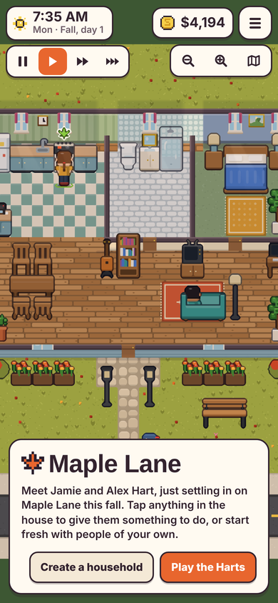
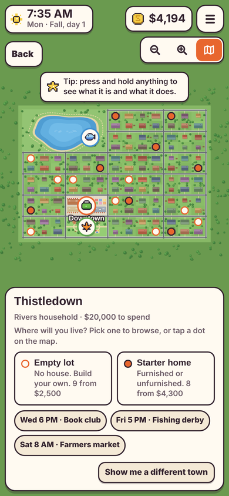
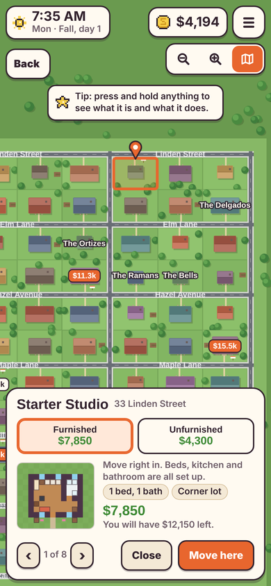
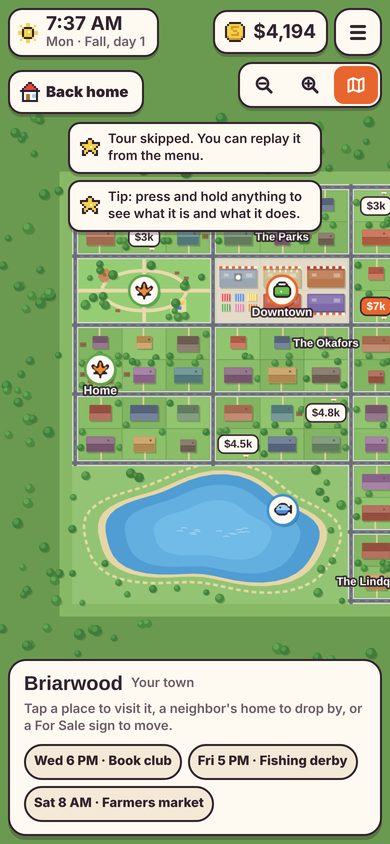

# Maplewood

A cozy life sim for phones (first called Maple Lane), in the spirit of The Sims 3, with pixel art and a procedurally
generated town. It runs as a single self-contained web page.

<p>




</p>

## What's in it

- **Life on the lot.** Sims with needs, moods, traits, skills, wishes and careers. Cook, sleep,
  chat with neighbors, garden, pay the bills at the mailbox.
- **Build and buy.** Drag out rooms, add doors and windows, paint floors and walls, and furnish
  from a catalog. A front door gets a stone path to the sidewalk.
- **A procedural town.** Every new household gets its own town: streets, a lake, a park, a
  downtown and neighbors. Start on an empty lot, or in a starter home that comes furnished or
  unfurnished. Everything fits the $20,000 starting budget.
- **Things to do in town.** Go fishing (six kinds of fish), visit the cafe, library, gym or
  museum, drop by a neighbor's house, and catch the weekly events: book club, fishing derby,
  farmers market and a park picnic.
- **Made for touch.** Press and hold anything for a tooltip, pinch to zoom, guided tours for the
  sample family (the Harts) and for new households.
- **Plays on a PC too.** Hover for tooltips, right-drag to move the camera, scroll to zoom, click to
  place furniture. Keys: Space pauses, 1 to 3 set the speed, arrows or WASD move the camera, + and -
  zoom, R turns an item, Esc backs out.
- **Original music.** Five songs composed in code, with day, night and build playlists.

## Run it

Needs `sh`, `python3` and `node` (node is only used for a syntax check).

```sh
sh build.sh
python3 -m http.server 8765 -d dist
```

Then open http://localhost:8765. Use a local server rather than opening the file directly, so
the music can load. Phone-sized windows (around 390x844) show it as intended; landscape and
tablet sizes work too.

`build.sh` writes two builds:

- `dist/index.html` keeps `window.__ML`, a debug hook the tests use.
- `dist/release/index.html` has the hook stripped. Publish this one, together with `music/`.
  It is static, so any static host works (GitHub Pages, Netlify). It's also published as a
  [claude.ai artifact](https://claude.ai/artifact/HaxB9ykWVRW4eo4vyF4YmC).

`.github/workflows/pages.yml` builds and publishes the release build to GitHub Pages on every
push to `main`. To turn it on, set the repo's Settings > Pages > Source to "GitHub Actions".

## Project layout

```
src/            the game, concatenated in order into one page by build.sh
  00_head.html    page shell and all CSS
  01_core.js      constants and data: needs, traits, skills, moods, catalog, careers, neighbors
  02_art.js       pixel art drawn in code: furniture, sims, portraits, icons
  03_world.js     the lot grid, walls, floors, rooms, placing objects
  03b_town.js     town generator, house designs, prices, places, events, fish
  04_sim.js       sims: needs, actions, queues, pathfinding, moods, trips away
  05_game.js      time, bills, seasons, saves, starting a household
  06_render.js    lot renderer and camera
  06b_gl.js       WebGL pass that smooths the pixel art
  07_ui.js        HUD, panels, modals, toasts, create-a-sim, phone
  07b_tips.js     press-and-hold tooltips
  07c_tut.js      guided tours and the home checklist
  07d_town.js     town map view, outings, moving house
  08_modes.js     buy and build tools, touch input, music player, sound effects
  08b_desktop.js  mouse and keyboard: hover, right-drag camera, strip scrolling, mouse wording
  09_main.js      start-up, frame loop, debug hook
  99_tail.html    closing tags
music/          the soundtrack (MP3)
tests/          Playwright scenario scripts, see tests/README.md
tools/music/    how the soundtrack was composed and rendered, see tools/music/README.md
docs/screens/   screenshots
```

## Saves

The game autosaves to `localStorage` (`mapleLane.save.v1`). When it runs as a claude.ai
artifact it also keeps a copy in the artifact's storage, so a save follows the player between
devices. Anywhere else that part is skipped.

## Credits

Fonts: Nunito and Pixelify Sans (Google Fonts). The soundtrack was rendered with the
GeneralUser GS soundfont by S. Christian Collins.
